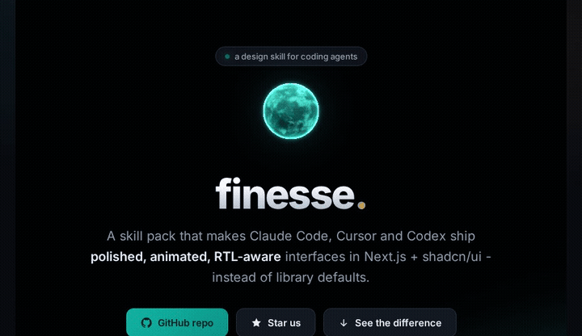
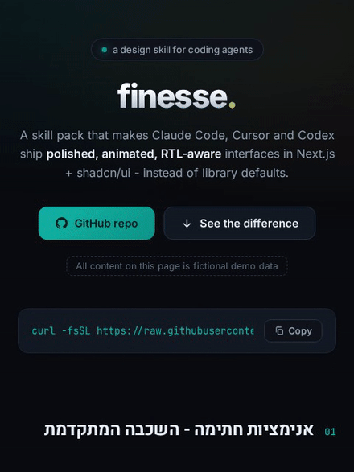
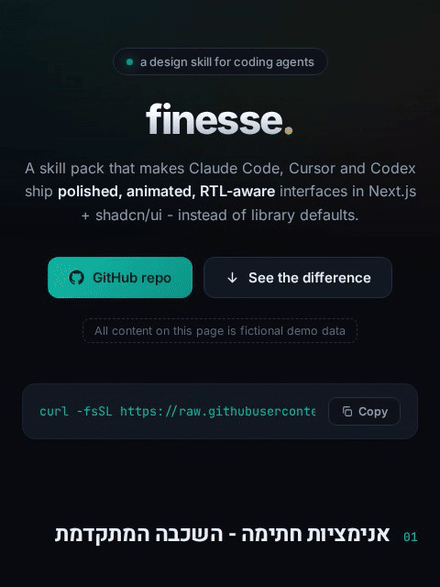

# finesse

**A design skill pack that makes coding agents ship polished, animated, RTL-aware interfaces - instead of library defaults.**

Works with Claude Code, Cursor, Codex and any agent that reads skill files. Built for app UI (dashboards, forms, lists, chats) on **Next.js + shadcn/ui + Tailwind + Framer Motion**.

**[Live before/after gallery](https://delevski.github.io/finesse/)** - toggle each component between the default agent output and the finesse version.



Full demo video: [docs/assets/demo.mp4](docs/assets/demo.mp4)

## Why

Ask a coding agent for a dashboard and you get the same thing every time: gray boxes, a submit button that silently does nothing, a blank screen while data loads, and a layout that shatters the moment it meets Hebrew.

finesse is a set of hard rules and copy-paste patterns the agent reads before it touches your UI:

1. **States first** - every action shows a pending state, guards double submits, and recovers with an inline error + retry. First load and every tab switch render a skeleton, never a blank screen.
2. **Tokens only** - no hex literals, no one-off grays; a real semantic theme, radius and elevation scale.
3. **Motion with intent** - staggered entrances, layout transitions, press feedback. Transform/opacity only, reduced-motion fallbacks everywhere. Plus a signature layer: Three.js scenes (aurora blob, particle fields), the eyeball switch, pointer-true ripple and magnetic hover - each with its fallback and performance budget.
4. **RTL native** - logical properties, mirrored directional icons, LTR islands for numbers and phones, Hebrew typography (Heebo/Assistant), Intl formatting. Built in from the first commit, not retrofitted.
5. **No dead controls, no invented content** - every rendered button works; demo data is labelled as demo.

## Install

One paste:

```bash
curl -fsSL https://raw.githubusercontent.com/delevski/finesse/main/install.sh | bash
```

The installer drops the skill into `~/.claude/skills/finesse` and `~/.agents/skills/finesse` (whichever exists).

| Harness | Where it lands | Invoke |
| --- | --- | --- |
| Claude Code | `~/.claude/skills/finesse` | `/finesse <path>` or "use finesse on this component" |
| Codex CLI / OpenCode | `~/.agents/skills/finesse` | mention finesse, or the `AGENTS.md` summary applies |
| Cursor | copy `cursor/rules/finesse.mdc` into `.cursor/rules/` | always-on rule |

## Use it

```
/finesse src/components/Dashboard.tsx     # apply the full bar to a component
/finesse audit src/app/settings           # report violations only, no edits
```

Or just say *"make this look designed"* in a project where the skill is installed.

## Signature components - drop-in via shadcn registry

44 animated components in the registry (58 live demos across the three galleries), installable straight into any shadcn/ui project:

| fan-drawer | swipe-stack | liquid-tabs |
| --- | --- | --- |
|  |  |  |

```bash
npx shadcn@latest add https://finesse-demo.orworkdelevski.workers.dev/r/fan-drawer.json
```

Available: `fan-drawer`, `swipe-stack`, `liquid-tabs`, `toast-physics`, `tilt-card`, `text-scramble`, `otp-input`, `flip-dialog`, `odometer`, `playground`, `pull-refresh`, `split-flap`, `empty-robot`, `cmd-palette`, `swipe-actions`, `step-walker`, `peel-skeleton`, `voice-note`, `sunset-toggle`, plus the motion gallery inspired by [designbookmark.com/motion](https://designbookmark.com/motion): `plan-switch`, `letter-limit`, `pull-cord`, `morph-tooltip`, `file-drop`, `morph-island`, `goo-menu`, `jelly-slider`, `hold-publish`, `rubber-dock`, `marker-text`, `word-roll`, `weight-wave`, `read-along`, `ghost-suggestion`, `goo-thinking`, `streaming-reply`, `like-burst`, `loading-success`, `star-rating`, `detent-dial`, `face-id`, `pagination-dots`, `tag-input`, `password-strength`. Sources live in `registry/finesse/` and are built into `docs/r/` by `scripts/build-registry.mjs`. Every component card in the live gallery also has a copy-TSX button.

## What's inside

```
skills/finesse/
  SKILL.md                      the bar + the flow
  references/
    states.md                   pending / empty / error / retry patterns (copy-paste React)
    motion-recipes.md           Framer Motion + CSS recipes with a timing vocabulary
    advanced-motion.md          signature animations: Three.js scenes, eyeball switch, ripple, magnetic hover
    rtl.md                      the complete RTL checklist: logical props, icon mirroring, bidi, Hebrew fonts
    shadcn-theme.md             semantic tokens, elevation scale, dark mode done right
    review-checklist.md         pre-ship self-review
  examples/before-after/        default output vs the finesse version, side by side
AGENTS.md                       condensed rules for Codex and generic agents
cursor/rules/finesse.mdc        always-on Cursor rule
docs/                           the live gallery (GitHub Pages)
```

## Site shaders

The live gallery's hero runs two real-time WebGL shaders adapted from [MengTo/threeui](https://github.com/MengTo/threeui) (MIT): a teal "emerald horizon" rising-glow backdrop and an animated energy orb as the logo mark. Both are dependency-free raw WebGL with reduced-motion and offscreen-pause fallbacks.

## Different from hallmark?

[hallmark](https://github.com/Nutlope/hallmark) is excellent for marketing pages and landing sites. finesse targets the other 90% of agent output: application UI - forms, dashboards, chats - on the Next.js + shadcn stack, with first-class RTL/Hebrew support and interaction states as hard rules.

## License

MIT - use it, fork it, ship with it.
